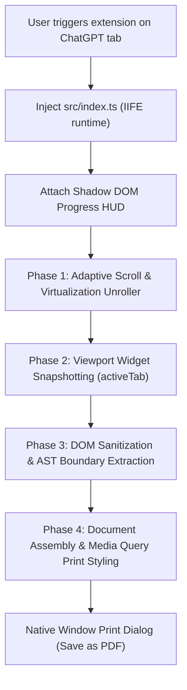

# Architecture & System Design — Export to PDF for ChatGPT

This document details the architectural design, algorithmic models, and security invariants implemented in **Export to PDF for ChatGPT**.

---

## 1. High-Level System Overview

Browser printing (`window.print()`) assumes that a web page's complete document object model (DOM) is resident in memory. Modern client-side single-page applications like ChatGPT violate this assumption through **DOM virtualization** (dynamically mounting and unmounting message nodes based on viewport proximity).

Furthermore, ChatGPT formats syntax-highlighted code with span-tokenized line wrappers that drop newline characters upon serialization, renders citation footnote pills with interactive popovers, and generates reactive charts using canvas or shadow DOM widgets that fail during print rasterization.

This extension implements a deterministic multi-stage pipeline to construct a standalone, print-optimized document from dynamic runtime state.



---

## 2. Core Subsystems

### 2.1. Adaptive Virtualization Scanner (`src/scanner/scroller.ts`)

ChatGPT virtualizes conversation turns using dynamic scroll containers (`[role="region"][aria-label="Conversation"]`). Unrendered turns simply do not exist in the DOM tree.

#### The Challenge:

Naive scrolling with fixed timeouts either skips virtualized turns (if scroll increments exceed render velocity) or causes severe performance degradation on large conversations (100+ turns).

#### The Solution:

The scanner operates via an adaptive sampling loop:

1. **Viewport Signature:** Computes a composite cryptographic-style fingerprint of the visible viewport:
   $$\text{Signature} = \text{scrollHeight} \parallel \sum (\text{turnKey} : \text{textLength} : \text{imageCount} : \text{textSlice})$$
2. **Double-Sample Settling Detection:** Requires at least two consecutive, identical signature samples separated by at least 145ms and image-load verification before considering a scroll window settled.
3. **Overlapping Window Traversal:** Advances scroll position by $50\%$ of the viewport client height ($\max(180\text{px}, \min(520\text{px}, 0.5 \times H_{\text{client}}))$). This ensures that short turns positioned near scroll boundaries are captured in at least two overlapping passes.
4. **Deduplication Map:** Turns are accumulated into an internal `Map<string, HTMLElement>` keyed by `${turnKey}:${roleSuffix}`, preserving the longest and most populated representation of each turn.

---

### 2.2. Code Line Boundary & Indentation Normalization (`src/dom/code.ts`)

Syntax highlighters (Prism, highlight.js, or custom React tokenizers) render code lines as inline `<span>` tokens or custom line wrappers.

```html
<!-- ChatGPT DOM Representation -->
<pre>
  <code>
    <span class="token-line"><span class="token keyword">const</span> <span class="token variable">x</span> = 1;</span>
    <span class="token-line"><span class="token keyword">const</span> <span class="token variable">y</span> = 2;</span>
  </code>
</pre>
```

#### The Problem:

When cloned outside ChatGPT's stylesheet or rendered in Chrome's print engine, `span.token-line` elements collapse into inline flow without explicit line breaks. This causes commands like `sudo apt update` and `sudo apt install` to concatenate into `sudo apt updatesudo apt install`.

#### The Algorithmic Fix:

`extractCodeText()` normalizes boundaries before DOM detachment:

1. Compares raw `textContent` newline count against rendered `innerText` newline count.
2. If rendered text contains line breaks not reflected in raw text, it inspects child elements for line attributes (`[data-line]`, `.token-line`, `display: block`).
3. Reconstructs real `\n` characters and preserves 4-space/2-space indentations.
4. Wraps the output in a clean, isolated `<pre><code>` block with `white-space: pre-wrap; overflow-wrap: anywhere;`.

---

### 2.3. Bounded Viewport Snapshotting (`src/capture/snapshot.ts` + `src/background.ts`)

Canvas-based graphs, SVG visualizations, and interactive widgets often fail during print formatting due to missing dynamic stylesheets or tainted canvas contexts.

#### Architecture:

1. **Target Identification:** `isSnapshotCandidate()` evaluates elements for specialized analytics hints (`chart`, `plot`, `recharts`, `echarts`, `plotly`, `map-widget`).
2. **Active Tab Capture:** Dispatches a runtime message `CHAT_PDF_CAPTURE_WIDGET` to the background service worker. The service worker calls `chrome.tabs.captureVisibleTab()` targeting the active window.
3. **Coordinate Normalization:** The content script calculates device-pixel-ratio (DPR) scaled bounding rectangles and crops the raw viewport screenshot onto an in-memory `<canvas>`.
4. **Fallback Invariant:** If snapshotting fails or times out, the system automatically retains the native HTML/SVG DOM fallback.

---

### 2.4. Memory Management & DOM Isolation (`src/ui/progress.ts`)

Exporting extensive conversations involves significant DOM cloning. Memory safety invariants are strictly enforced:

- **Shadow DOM Isolation:** The progress indicator is mounted into a closed Shadow Root (`progressHost.attachShadow({ mode: 'closed' })`). This guarantees that host page styles never alter the progress HUD, and HUD markup never leaks into the conversation document.
- **Weak References:** Transient node sets (`userAttachmentNodes`) and snapshot caches use `Set<Element>` and `WeakMap<Element, string>`, allowing collected DOM references to be garbage collected as soon as turns unmount.
- **Progress Visibility:** The progress HUD is temporarily hidden (`visibility: hidden`) during snapshot cropping frames to prevent progress bars from appearing in captured diagrams.

---

## 3. Security & Sandboxing Model

The extension operates under a strict **Zero-Trust Client-Side** model:

| Boundary                        | Enforcement Mechanism                                                                                                                                                                                             |
| :------------------------------ | :---------------------------------------------------------------------------------------------------------------------------------------------------------------------------------------------------------------- |
| **Network Isolation**           | Zero remote network requests (`fetch`, `XMLHttpRequest`, analytics beacons, or telemetry). All parsing runs in browser memory.                                                                                    |
| **Origin Scoping**              | Permissions restricted strictly to `https://chatgpt.com/*` and user-invoked `activeTab`.                                                                                                                          |
| **SVG Sanitization**            | External SVG `<image href="...">`, `xlink:href`, and CSS `url(...)` declarations are filtered to prevent SSRF or external tracking pings. Only internal fragment identifiers (`#id`) and local blobs are allowed. |
| **Executable Script Stripping** | `<script>`, `<style>`, `<object>`, `<embed>`, and `<iframe aria-hidden>` tags are purged during DOM tree walking. `javascript:` URI schemes in anchors are stripped.                                              |

---

## 4. Build & Verification Pipeline

```text
TypeScript Sources (src/*.ts)
  │
  ├──> tsc --noEmit (Strict Type Checking)
  │
  ├──> vitest run (Automated DOM Fixture Unit Tests)
  │
  └──> esbuild (Bundle to IIFE export.js, ESM background.js, IIFE options.js in <10ms)
        │
        └──> scripts/package.js (Assembles dist/ and compresses upload zip)
```
