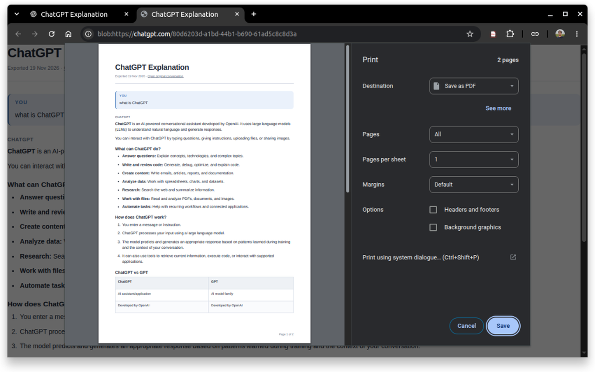
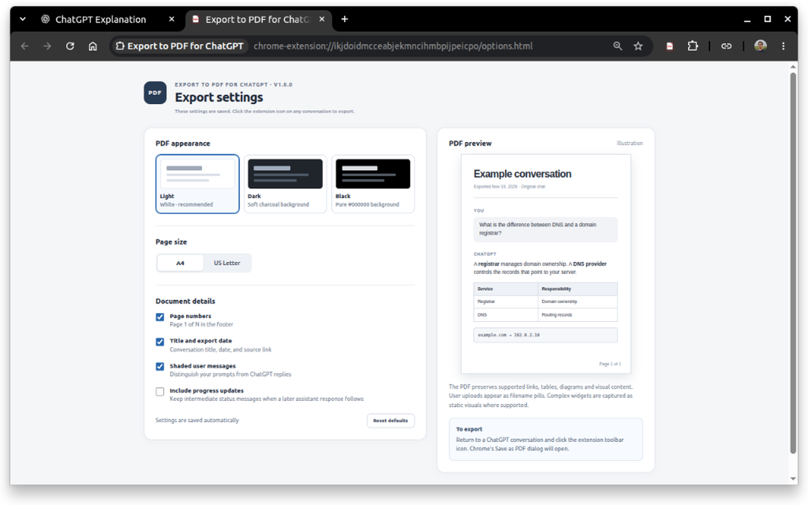

# Export to PDF for ChatGPT

A privacy-first Chrome Extension (Manifest V3) to export full ChatGPT conversations into beautifully formatted, readable PDFs through Chrome's native **Save as PDF** print dialog.

[](https://chromewebstore.google.com/detail/export-to-pdf-for-chatgpt/pfkbinehddbjfacdgcghoflahnllcpaf)
[](https://github.com/gauravdalvi2012/export-to-pdf-for-chatgpt/actions/workflows/ci.yml)
[](#️-development--build-scripts)
[](LICENSE)

---

## 🎯 Why This Extension?

Standard browser printing (`Ctrl+P` / `Cmd+P`) fails on ChatGPT because of **DOM virtualization**: ChatGPT only renders conversation turns currently near the viewport, meaning long conversations get cut off. Furthermore, syntax-highlighted code blocks often lose newlines, citations clutter the text, and charts fail to print.

This extension solves these issues by intelligently scanning the full conversation history, stabilizing rendered DOM elements, preserving code formatting, and applying a print-tailored stylesheet.

---

## 🖼️ Preview

<div align="center">
  
  <p><em>Complete unrolled conversation rendering in Chrome's native print preview dialog with headers, page numbers, and preserved code blocks.</em></p>
  <br />
  
  <p><em>Customizable print options: Light (paper standard), Dark, and OLED Black themes, paper formats (A4 / US Letter), and display toggles.</em></p>
</div>

---

## ✨ Features

- **Full Conversation Scanning:** Automatically scrolls through and captures long, virtualized conversations from the first prompt to the final reply without skipping turns.
- **Code Block Correctness:** Extracts true rendered line boundaries and indentation from syntax-highlighted code blocks (Bash, Python, JSON, etc.), preventing concatenated code.
- **Visual Snapshotting:** Captures rendered assistant diagrams, charts, and custom CSS/canvas widgets as high-resolution static snapshots via Chrome's tab capture API.
- **Citation Cleanup:** Automatically strips distracting search popovers and footnote pills (e.g. `OBS`, `GitHub` source chips) while keeping genuine hyperlinks intact.
- **Compact Attachment Pills:** Replaces user-uploaded files and screenshots with neat metadata badges rather than broken image tags or empty spaces.
- **Customizable Print Themes:**
  - **Light** (`#FFFFFF`) — standard paper print (recommended).
  - **Dark** (`#1F2329`) — easy on the eyes.
  - **Black** (`#000000`) — high-contrast OLED black.
- **Paper Formats & Options:** Supports **A4** and **US Letter**, optional page numbering (`Page X of Y`), conversation title, export timestamp, and source links.
- **100% Private & Local:** All parsing and formatting happens entirely inside your browser memory. Nothing is ever sent to an external server.

---

## 🚀 Installation & Usage

### Option 1: Install from Chrome Web Store (Recommended)

Install directly from the [Chrome Web Store](https://chromewebstore.google.com/detail/export-to-pdf-for-chatgpt/pfkbinehddbjfacdgcghoflahnllcpaf) with one click.

### Option 2: Build & Load from Source (Developer Mode)

1. Clone or download this repository:
   ```bash
   git clone https://github.com/gauravdalvi2012/export-to-pdf-for-chatgpt.git
   cd export-to-pdf-for-chatgpt
   ```
2. Install dependencies and build:
   ```bash
   npm install
   npm run build
   ```
3. Open Chrome and navigate to `chrome://extensions`.
4. Enable **Developer mode** in the top-right corner.
5. Click **Load unpacked** and select this project folder.
6. Open any conversation on [chatgpt.com](https://chatgpt.com) and click the extension icon in your Chrome toolbar.
7. Select **Save as PDF** in Chrome's print dialog.

---

## 🛠️ Development & Build Scripts

The codebase is written in TypeScript, organized into modular domain modules under `src/`, bundled with `esbuild`, and tested with `vitest`.

| Command                 | Description                                                                                                                          |
| :---------------------- | :----------------------------------------------------------------------------------------------------------------------------------- |
| `npm run build`         | Compiles `src/` TypeScript entry points into root bundles with esbuild.                                                              |
| `npm run watch`         | Watches `src/` for file changes and rebuilds automatically.                                                                          |
| `npm run typecheck`     | Runs strict TypeScript verification across `src/` and `test/` without emitting.                                                      |
| `npm test`              | Runs the full Vitest automated test suite against simulated ChatGPT DOM fixtures.                                                    |
| `npm run test:coverage` | Executes Vitest with v8 coverage provider and generates terminal & HTML coverage reports.                                            |
| `npm run format`        | Formats the codebase using Prettier.                                                                                                 |
| `npm run format:check`  | Verifies code formatting with Prettier without modifying files.                                                                      |
| `npm run package`       | Builds the project, prepares a clean `dist/` directory, and generates `dist/export-to-pdf-for-chatgpt.zip` for the Chrome Web Store. |

---

## 📂 Project Structure

For an in-depth breakdown of algorithmic models, AST extraction, and security invariants, read [ARCHITECTURE.md](ARCHITECTURE.md). To contribute, see [CONTRIBUTING.md](CONTRIBUTING.md).

```text
├── .github/
│   ├── assets/            # High-resolution visual showcase and preview screenshots
│   ├── badges/            # Live SVG and JSON coverage badge assets
│   └── workflows/         # GitHub Actions CI automated pipeline
├── manifest.json          # Chrome Extension Manifest V3 configuration
├── options.html / .css    # Settings page (theme, page size, display options)
├── icons/                 # Extension icons (16px, 32px, 48px, 128px)
├── prettier.config.js     # Code formatting configuration
├── scripts/
│   ├── generate-badge.js  # Automated SVG and Shields.io coverage badge builder
│   └── package.js         # Automated distribution and zip packaging script
├── src/
│   ├── index.ts           # Main export orchestrator and lifecycle coordinator
│   ├── background.ts      # Service worker for activeTab widget capture
│   ├── options.ts         # Options storage and live preview logic
│   ├── types.ts           # TypeScript interfaces for settings, turns, and snapshots
│   ├── config.ts          # Defaults, palettes, tag/attribute sets, regex patterns
│   ├── utils.ts           # DOM helpers, safe URL validators, CSS helpers
│   ├── ui/
│   │   └── progress.ts    # Shadow DOM progress overlay with cancellation
│   ├── scanner/
│   │   └── scroller.ts    # Adaptive scrolling, DOM settling & boundary checks
│   ├── capture/
│   │   └── snapshot.ts    # Widget detection & bounding box screenshot cropper
│   ├── dom/
│   │   ├── cleaner.ts     # DOM sanitizer and structure normalizer
│   │   ├── code.ts        # Code line boundary and indentation preservation
│   │   ├── citations.ts   # Citation pill and popover badge detection
│   │   ├── attachments.ts # File upload cards and attachment badge parser
│   │   └── visual.ts      # Layout grids, color blocks & table head normalizer
│   └── print/
│       ├── styles.ts      # Print media CSS, @page rules & pagination controls
│       └── document.ts    # Document assembly, progress filtering & print trigger
└── test/
    ├── config.test.ts     # Configuration and palette schema tests
    ├── utils.test.ts      # URL sanitizer and CSS string escape tests
    ├── capture/
    │   └── snapshot.test.ts   # Widget detection and snapshot tests
    ├── dom/
    │   ├── attachments.test.ts # Attachment card and uploaded image badge tests
    │   ├── citations.test.ts   # Citation pill stripping without breaking real links
    │   ├── cleaner.test.ts     # DOM sanitization and table normalization tests
    │   ├── code.test.ts        # Indentation and line boundary preservation tests
    │   └── visual.test.ts      # Media dimension scaling and table header tests
    ├── print/
    │   ├── document.test.ts    # Document assembly and print window popup tests
    │   └── styles.test.ts      # CSS palette and print style generation tests
    ├── scanner/
    │   └── scroller.test.ts    # Virtual DOM viewport scanner and settling tests
    └── ui/
        └── progress.test.ts    # Shadow DOM progress modal lifecycle tests
```

---

## ⚠️ Limitations & Notes

- **DOM Virtualization Dependency:** Relies on ChatGPT's conversation DOM structure (`[data-turn-key]`, `[role="region"]`). If OpenAI changes internal markup, an update may be required.
- **User Uploads:** User-uploaded images are intentionally represented as compact filename pills rather than embedded full-size images to keep documents clean and lightweight.
- **Authenticated Downloads:** Files hosted behind ChatGPT session authentication (e.g. generated download links) require the original live conversation to access.

---

## 🔒 Privacy Policy

This extension runs **strictly client-side**. It does not collect, store, transmit, or sell any personal data, chat transcripts, or telemetry.

- Full Policy in Repo: [PRIVACY.md](PRIVACY.md)
- Official Web Version: [gauravdalvi.com/privacy/export-to-pdf-for-chatgpt](https://gauravdalvi.com/privacy/export-to-pdf-for-chatgpt)

---

## ⚖️ Disclaimer

This is an independent open-source tool and is not affiliated with, endorsed by, or sponsored by OpenAI or ChatGPT.
